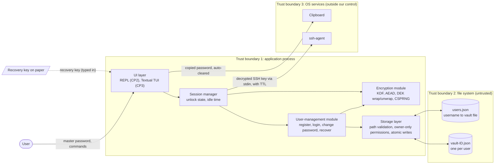
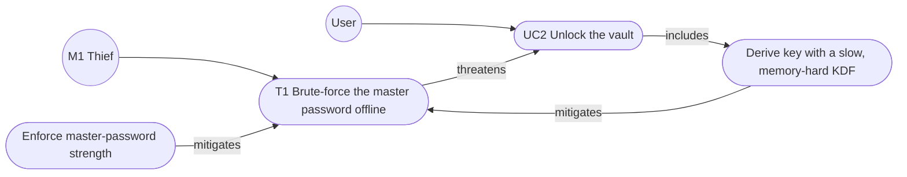

# Design Document: Password Manager

ICS0022 Secure Programming, semester project. Written for Checkpoint 1 (threat model and
architecture) and kept up to date while the code is built: §6 records where the build differs from
the original design, and §7 maps every threat to the code and tests that handle it.

## 1. Assets

Threat-modelling step 1: identify what the system must protect.
C = confidentiality, I = integrity, A = availability.

| # | Asset | Where it lives | Protect |
|---|---|---|---|
| A1 | **Stored credentials**: site usernames, passwords, URLs, notes | Encrypted in the user's vault file; plaintext in RAM while unlocked | C, I, A |
| A2 | **Master password** | User's memory, then keyboard/terminal input, then RAM until the key is derived | C |
| A3 | **Keys**: the key-encryption key (KEK) derived from the master password, and the random data key (DEK) that encrypts the vault | RAM only, while unlocked; the DEK is stored on disk only in wrapped (encrypted) form | C |
| A4 | **Vault file**: ciphertext, wrapped DEKs, KDF salt and parameters, nonce, authentication tag | Disk, one file per user | I, A |
| A5 | **User account records**: username to vault-file mapping | Disk | I |
| A6 | **TOTP secrets**: 2FA seeds for the user's other accounts | Inside the vault; RAM while unlocked | C |
| A7 | **SSH private keys** | Inside the vault; RAM; the OS ssh-agent until the TTL expires | C |
| A8 | **Transient output**: clipboard contents, terminal screen and scrollback | OS clipboard, terminal | C |
| A9 | **Recovery key**: shown once at registration, kept by the user on paper | Paper (outside the system); RAM while it is being used | C |

Notes:

- A1 and A4 are the same data in two states. The file's confidentiality comes from encryption, but the
  file itself must also be protected against tampering, rollback to an older copy, and loss.
- The KEK and the DEK (A3) are more valuable than the master password: anyone holding them does not need
  the password at all, and they stay in memory for the whole unlocked session.
- TOTP secrets (A6) are stored next to the passwords, so one breach of the vault defeats both factors.
  This is a deliberate usability trade-off.
- The recovery key (A9) is a second way into the vault, as powerful as the master password. It exists
  for availability: without it, a forgotten master password means the vault is permanently lost.

## 2. Architecture

Threat-modelling steps 2 and 3: architecture overview and decomposition.

The UI is a thin layer on top of a UI-independent core, so the prompt REPL (CP2) can be replaced by a
Textual TUI (CP3) without touching any security code. The UI never handles keys or files directly.



### Components

| Component | Responsibility | Holds secrets? |
|---|---|---|
| UI layer | Reads input, shows results. Masks password input and never echoes secrets. | Master password briefly, while it is passed on |
| Session manager | Keeps the unlocked state and measures idle time. Locking discards the keys: on `lock` or `quit`, or after 5 minutes without input, which the UI checks with a timer of its own (§6, D14) | DEK while unlocked |
| User-management module | Registration, login, master-password change, recovery-key unlock; one vault per user | Master password and KEK, briefly |
| Encryption module | Derives keys from passwords, encrypts and decrypts the vault (authenticated), wraps and unwraps the DEK, generates passwords and keys with a CSPRNG | Keys only for the duration of a call |
| Storage layer | The only component that touches the disk: validates paths, creates files with owner-only permissions, writes atomically (temp file, then rename) | Never plaintext, only ciphertext |

### Where files and keys live

| Item | Location | Form |
|---|---|---|
| Data directory | `~/.yunarpass/` by default, overridable with the `YUNARPASS_HOME` environment variable (never with a command-line path) | Created owner-only; refused at startup if it is a link or junction, belongs to another user, or anyone else has access |
| Vault contents (A1, A6, A7) | `vault-<id>.json` in the data directory | Encrypted and authenticated with the DEK |
| DEK | Vault file header | Wrapped twice: by the KEK from the master password, and by the key from the recovery key |
| KEK | RAM only | Derived at login, discarded after the DEK is unwrapped |
| DEK in plaintext | RAM only | Only while unlocked; dropped on lock, auto-lock or exit |
| Master password / recovery key | Never stored | Typed in, used to derive a key, then dropped |
| Account records (A5) | `users.json` | No secrets; its integrity is checked because each vault is bound to its username |
| Previous versions | `users.json.bak` and `vault-<id>.json.bak`, next to each file | The version before the last save, in the same form as the file; written as atomically as the file itself |

### Trust boundaries

1. **User and terminal to process.** All input is untrusted and validated against an allow-list
   (entry names, lengths, commands).
2. **Process to file system.** The disk is untrusted: another OS user, malware or a backup tool may
   read, copy, replace or roll back files. Everything written there is therefore encrypted and
   authenticated, and file paths are never built from raw user input.
3. **Process to OS services.** Data given to the clipboard or the ssh-agent leaves our control. We
   limit its lifetime (clipboard clearing, agent TTL) but cannot enforce it.
4. **User to user.** Accounts are separated cryptographically: each user has their own vault and their
   own keys. One user's password can never decrypt another user's vault.

### Data flow: unlock

1. The user enters their username and master password (input masked).
2. The storage layer finds the user's vault file through `users.json` and reads it. The vault must
   name the same username and vault ID as `users.json`, or it is another user's vault put in its
   place (T8).
3. The encryption module derives the KEK from the password and the salt in the header, then unwraps the DEK.
   If the authentication tag fails, the login fails with a generic error; there is no separate password check that could leak information.
   An unknown username, a missing or damaged vault and a wrong password all fail the same way, after one Argon2id run each (T4),
   and every failure makes the next attempt wait longer (T2).
4. The DEK decrypts the vault into RAM. The password and the KEK are dropped.
5. The session manager keeps the DEK until lock, auto-lock or exit. Every change is saved at once: the body is encrypted again under a fresh nonce with its counter one higher,
   and the vault file is replaced atomically, but only if it is still the version this session loaded or last saved (T28).

## 3. Threat model

Threat-modelling steps 4 to 6: identify, document and rate the threats. Threats are written as
**misuse cases** (Alexander, *Misuse Cases*, 2003): a misuse case **threatens** a use case, and a use
case (a security function of the tool) **mitigates** a misuse case.

### Use cases

| ID | Use case |
|---|---|
| UC1 | Register an account (creates the vault and shows the recovery key once) |
| UC2 | Unlock the vault (log in) |
| UC3 | Add, view, edit or delete an entry |
| UC4 | Copy a password to the clipboard |
| UC5 | Generate a password |
| UC6 | Lock / auto-lock |
| UC7 | Change the master password |
| UC8 | Recover access with the recovery key |
| UC9 | Show a TOTP code |
| UC10 | Load an SSH key into the ssh-agent |

### Misusers

| ID | Misuser | Capability |
|---|---|---|
| M1 | **Thief** | Has a copy of the files: stolen laptop or disk, backup, cloud sync. Unlimited offline time. |
| M2 | **Local user** | Another person or OS account on the same machine, or another account of this tool. |
| M3 | **Malware** | Code running as the same OS user while the tool is in use. |
| M4 | **Onlooker** | Can see the screen or the paper recovery key. |

Rating: likelihood (L/M/H) times impact (L/M/H) gives a risk of Low, Medium or High.

### Example misuse-case diagram (master password area)



### Master password (A2, A9)

| ID | Misuse case (misuser) | Threatens | Risk | Mitigation | Residual risk |
|---|---|---|---|---|---|
| T1 | Brute-force the master password offline against a copied vault file (M1) | UC2 | High | Memory-hard KDF (Argon2id) with a per-user random salt; at least 12 characters and not in a blocklist of the 10 000 most common passwords (ignoring case), checked at UC1/UC7 | A weak but allowed password can still be guessed eventually |
| T2 | Guess passwords online at the login prompt (M2) | UC2 | Medium | The KDF makes every attempt slow; a delay of 1 s after the first failure, doubling after each further one up to 32 s (§6, D11). A wrong current password at `passwd` and a failed `recover` count as failures too, with the same delay. The next attempt waits out the delay first, so interrupting the wait with Ctrl-C does not skip it. The delay values are constants in the code; configuration can only make them stricter | The offline attack (T1) skips our program entirely, so only the KDF cost applies there. The delay is kept by the running program, so restarting it starts again at 1 s; every attempt still costs a full Argon2id derivation |
| T3 | Read the password as it is typed (M4) | UC2 | Low | Masked input, never echoed. An unknown command is not printed back either, in case it was a password typed at the wrong prompt | Physical observation of the keyboard |
| T4 | Learn which usernames exist from error messages or timing (M2) | UC2, UC8 | Low | One generic login error, also for a missing, damaged or swapped vault; the KDF also runs for unknown usernames. `recover` likewise fails with one error for an unknown username and for a wrong or malformed key | None significant |
| T5 | Steal or photograph the paper recovery key (M4) | UC8 | Medium | High-entropy key shown only once and typed back at a masked prompt; using it forces a new master password and a new recovery key, so a key that has been used never opens the vault again | Unlike 1Password's Emergency Kit, which is a second factor, our recovery key alone opens the vault. This is a deliberate trade of confidentiality for availability |

### Vault at rest (A1, A4, A5, A6, A7)

| ID | Misuse case (misuser) | Threatens | Risk | Mitigation | Residual risk |
|---|---|---|---|---|---|
| T6 | Read the vault file from the disk or a backup (M1) | UC3 | High | The whole vault is encrypted with authenticated encryption (AEAD); plaintext is never written to disk, not even to temp files | Depends on T1 (password strength) |
| T7 | Tamper with the vault, e.g. weaken the KDF parameters in the header (M1, M2) | UC2, UC3 | Medium | The header is authenticated as associated data; KDF parameters below a minimum hard-coded in the program are rejected when loading, and configuration can only raise them. Parameters above a hard-coded maximum are rejected too, so an edited header cannot make the program exhaust memory before the check fails | None significant |
| T8 | Swap vault files between users or edit `users.json` (M2) | UC2 | Medium | The username is bound to the vault as associated data, so a swapped vault fails to decrypt. At login the vault must also name the username and vault ID that `users.json` maps, so an edited `users.json` cannot hand one user's vault to another account name | None significant |
| T9 | Roll the vault back to an older copy (M1, M2) | UC3 | Low | A version counter inside the encrypted vault is shown to the user after unlock | Not fully preventable locally: the attacker can roll back every file at once. Accepted |
| T10 | Crash or power loss during a save corrupts the vault (availability) | UC3 | Medium | Atomic save: write a private temp file in the same directory, flush and fsync it, then rename it over the file, and make the rename durable (directory fsync on POSIX, `MOVEFILE_WRITE_THROUGH` on Windows). The previous encrypted copy is kept as `.bak` | Disk failure; users are told to back up the vault file. A crash can leave a temp file behind; it holds only ciphertext, is owner-only and is never read |
| T11 | Path traversal or a symlink/hard link through a crafted username or file name (M2) | UC1, UC2 | Medium | Vault file names are random IDs, never the username; usernames are checked against an allow-list; the tool refuses symlinks, other reparse points, files with a second hard link and files it does not own, and checks that the file it opened is the one it checked (lstat, open, fstat, compare); file names come from a fixed allow-list; the data directory is owner-only | None significant |
| T12 | Another OS user reads the vault files (M2) | UC3 | Low | Files created owner-only, as defence in depth on top of T6: mode 0600 (directory 0700) on POSIX; on Windows a protected ACL that grants access to the current user only, set when the file is created, so there is no moment when the file is readable by others (§6). The directory is checked again at startup and every file when it is opened; anything that belongs to another user or grants anyone else access is refused, not repaired | An administrator can always read them, but only as ciphertext |
| T28 | Two open sessions of the same account, such as two prompts (or later the CLI and the GUI), overwrite each other's saves (availability). *Added in CP2* | UC3 | Low | Before every save the vault file is read again and must still be the version the session loaded or last saved; otherwise the save is refused and the user is told to log in again | The check and the write are two steps, so two saves at the same moment can still race. The overwritten version is then the `.bak` copy |

### Vault in memory (A1, A2, A3)

| ID | Misuse case (misuser) | Threatens | Risk | Mitigation | Residual risk |
|---|---|---|---|---|---|
| T13 | Read secrets from the process memory (M3) | UC2, UC3 | Medium | Secrets are kept alive as briefly as possible: the password and KEK are dropped right after the DEK is unwrapped, and the DEK is dropped on lock. The KEK and the DEK are written by the library straight into `bytearray` buffers (`derive_into`, `decrypt_into`), which are zeroed when no longer needed, so these keys never exist as immutable `bytes` in Python. Wiping is best-effort only | Python `str` is immutable, so the master password itself cannot be overwritten, and the library may keep internal copies of keys. Wiping cannot be guaranteed; only the lifetime is controlled. Malware running as the user is ultimately out of scope (see Assumptions) |
| T14 | Secrets written to disk through the pagefile, swap or a crash dump (M1) | UC2 | Low | Core dumps disabled where the OS allows it; secrets kept in memory only briefly | The Windows pagefile cannot be controlled from Python. Accepted |
| T15 | Use an unlocked session left unattended (M2, M4) | UC3 | Medium | Auto-lock after 5 minutes without input, a limit that can only be lowered; `lock` command. Locking zeroes the DEK, drops the entries and clears our copy from the clipboard. Idle time is measured on the monotonic clock and on the wall clock, which keeps counting while the computer sleeps, and input that arrives after the timeout locks the vault before it is used. The first line typed after an auto-lock is not run | Within the timeout window |

### Interface (A2, A8)

| ID | Misuse case (misuser) | Threatens | Risk | Mitigation | Residual risk |
|---|---|---|---|---|---|
| T16 | Secrets leak into the shell history or process list (M2, M3) | UC2, UC3 | Medium | Secrets are never accepted as command-line arguments, only through masked prompts | None significant |
| T17 | Secrets leak through logs, error messages or tracebacks (M2) | all | Medium | No secrets are logged; the user sees generic errors, never raw tracebacks | None significant |
| T18 | Read a copied password from the clipboard or clipboard history (M3) | UC4 | Medium | Clipboard cleared after 20 seconds, but only if it still holds our value, so a newer copy by the user is never overwritten; also cleared on lock and quit. To recognise its copy, the program keeps only an HMAC of it under a key made for that copy, not the password itself. On Windows the copy is marked with the `ExcludeClipboardContentFromMonitorProcessing`, `CanIncludeInClipboardHistory` = 0 and `CanUploadToCloudClipboard` = 0 formats, which keep it out of the Win+V history and the cloud clipboard | Any process of the same user can read the clipboard within the 20 s, and third-party clipboard managers may ignore the exclusion formats. Accepted and documented |
| T19 | Malicious input: overlong fields, control characters, terminal escape sequences in entry names (M2) | UC3 | Low | Allow-list validation and length limits at input (commands, 256-character command lines); control characters, terminal escape sequences and bidirectional controls removed from every line printed | None significant |
| T20 | Guess generated passwords because they are predictable | UC5 | High if present | Generated with the `secrets` CSPRNG, never `random` | None significant |
| T25 | Read a stored or generated password from the screen, the terminal scrollback or a screen recording (M4, M3). *Added in CP2, see §6* | UC3, UC5 | Medium | Passwords are never printed: `show` always masks, `gen` copies the password or fills it into the entry, and `copy` is the only way to use a stored password | The recovery key is printed once at registration and recovery, because the user must write it down; it stays in the scrollback until the terminal is closed or cleared (see T5) |
| T29 | Change or delete the wrong one of two similar entries, such as two `github` logins (availability). *Added in CP2* | UC3 | Low | Every entry has a random ID, and its short form is shown by `list`, `show` and every message about an entry. A name that several entries share is refused by `edit` and `rm`, which list those entries with their IDs instead; `show` and `copy` ask which one is meant. `rm` shows the entry and deletes it only after `yes` is typed | The user can still choose the wrong ID. The version before the last save stays in the `.bak` file |

### Extra features and supply chain

| ID | Misuse case (misuser) | Threatens | Risk | Mitigation | Residual risk |
|---|---|---|---|---|---|
| T21 | One vault breach reveals both a password and its TOTP secret (M1, M3) | UC9 | Medium | Same protection as the rest of the vault | Storing both factors together is a deliberate usability trade-off. Accepted and documented |
| T22 | Another process uses or reads an SSH key loaded into the agent (M3) | UC10 | Medium | The key goes to `ssh-add` through stdin, never as a file; loaded with a 10-minute lifetime (`-t 600`) | Any process of the same user can use the agent until the lifetime ends |
| T23 | A malicious or vulnerable dependency (supply chain) | all | Medium | Few, well-known libraries; pinned versions; dependency scanning in CI | Trust in the chosen libraries |
| T24 | Modify the installed program or its dependencies to capture the master password (M2, M3) | UC2 | Medium | Installed where normal users cannot write; dependencies pinned with hashes (`pip --require-hashes`); release checksums published for verification | Anyone who can write to the install can change anything. A self-check inside the program could simply be removed, so none is claimed. The vault does not depend on the program: without the password, a modified copy cannot decrypt anything |

### Assumptions and out of scope

- The operating system and the Python interpreter are not compromised. Malware with administrator
  rights, keyloggers and kernel-level attacks can defeat any local password manager.
- Hardware attacks such as cold-boot memory attacks are out of scope.
- The user chooses a master password that meets the policy, and keeps the recovery key private.

## 4. Cryptographic scheme and vault format

Initial design decision. Every choice below traces back to a threat in section 3.

### Scheme: envelope encryption

```
master password --Argon2id(salt)-------> KEK_pw --AES-256-GCM wrap--+
                                                                    +--> DEK (random 256-bit) --AES-256-GCM--> vault body
recovery key   --HKDF-SHA256(salt)----> KEK_rk --AES-256-GCM wrap--+
```

| Element | Choice | Why (threat) |
|---|---|---|
| Password KDF | **Argon2id**, 64 MiB memory, 3 iterations, 4 lanes, 16-byte random salt, 32-byte output (RFC 9106 recommended profile). The password is Unicode-normalized (NFC) and UTF-8 encoded first | Slow and memory-hard, so offline guessing on GPUs is expensive (T1). The salt defeats precomputed tables. NFC makes the same password typed with composed or decomposed accents give the same key |
| Parameter floor and ceiling | The minimums above are constants in the code; a vault header with weaker parameters is refused. A maximum (1 GiB, 64 iterations, 16 lanes) is enforced the same way | T7: an attacker cannot make brute force cheaper by editing the header or a config file, nor make the program allocate unbounded memory before the tag check can fail |
| Data key (DEK) | 256 random bits from the OS CSPRNG (`secrets`) | Independent of the password, so changing the password only re-wraps the DEK (UC7) |
| Encryption | **AES-256-GCM** (authenticated encryption, AEAD) for the vault body and for each wrapped DEK | Confidentiality (T6) and integrity: any modified byte makes decryption fail (T7, T8) |
| Nonces | A fresh random 96-bit nonce for every encryption, including every save | A nonce must never repeat under the same key. With random nonces, the safe limit (about 2^32 encryptions per key) is far beyond our save volume |
| Associated data | Each of the three encryptions has its own associated data (AAD), authenticated but not encrypted. All three contain the vault's identity: format version, vault ID and username. The password copy of the DEK also binds the Argon2id parameters and salt, and the recovery copy its HKDF salt. A purpose label keeps the three distinct (§6, D10) | A vault renamed to another user or swapped into another user's place fails all three decryptions (T8). Weakened or edited KDF inputs make their own copy of the DEK fail (T7) |
| Password change (UC7) | The current password must unwrap the DEK first, with the same delay as a failed login, and the new one must meet the policy. A new salt and KEK are derived from the new password, keeping the stored Argon2id parameters, and the password copy of the DEK is re-wrapped; the body and the recovery copy are unchanged, which works because neither binds the password's KDF inputs | The vault is never re-encrypted, so a change is fast and cannot half-complete. The DEK itself stays the same, so someone who already has the old password and a copy of the vault file can still open that copy. Replacing the DEK would mean encrypting the body again and re-wrapping the recovery copy, which needs the recovery key; it is not offered |
| Recovery key | 160 random bits, shown once as 32 Base32 characters in 8 groups of 4 (`ABCD-EFGH-…`); typed back in either case, with spaces and dashes ignored and anything else refused. Its KEK is derived with **HKDF-SHA256** from the key and a 16-byte salt, with the fixed label `yunarpass/recovery-kek/v1` as HKDF `info` | It is already high-entropy, so a slow KDF is not needed. Base32 has no 0, 1, 8 or 9, which are easy to misread on paper. The label keeps this key separate from any other key derived from the same input. Using it forces a new master password and a new recovery key (T5) |
| Recovery (UC8) | The new master password must meet the policy, which is checked first. Then the KEK from the typed key must unwrap the recovery copy of the DEK; an unknown username, a wrong or malformed key and a damaged vault all fail with one error and the same delay as a failed login. On success both copies of the DEK are wrapped again: the password copy under the new password with a new Argon2id salt, the recovery copy under a new random recovery key with a new HKDF salt. The body is unchanged, the vault is saved atomically with the same changed-elsewhere check as any save, and the new key is shown once | A key that has been used may be on paper that someone else has seen, so it never opens the vault again (T5). The password copy is replaced too, so the forgotten password, which someone else may know, stops working as well. As with a password change, the DEK stays the same, with the same residual risk |
| Login check | No password hash is stored. A wrong password fails the tag check when unwrapping the DEK | No extra offline target on disk; one generic error (T4) |
| Password generator | `secrets.choice` over 90 characters: letters, digits and 28 symbols (no quotes, backslash, backtick or space). 20 characters by default (about 130 bits), 12 to 128 allowed. Every class appears at least once; a candidate missing one is redrawn (rejection sampling) | CSPRNG output, not predictable (T20). Redrawing keeps every allowed password equally likely, whereas forcing a class into a fixed position would make guessing easier. The left-out symbols are the ones web forms and shells often mishandle |
| TOTP codes | `cryptography`'s TOTP implementation (RFC 6238) | No extra dependency (T23) |

### Vault file format (`vault-<id>.json`, format version 1)

A UTF-8 JSON document. Binary fields are Base64-encoded. It is parsed strictly, and anything
unexpected is rejected before any cryptography runs (T7, T19): a format other than 1; unknown,
missing or duplicate fields (plain `json.loads` would silently keep the last of two); wrong types,
including `true` where a number is expected; Base64 that is not canonical or decodes to the wrong
length; KDF parameters outside the floor and ceiling; a vault ID that is not 32 lowercase hex
digits; a username outside `[a-z0-9][a-z0-9_-]{2,31}`; and files over 8 MiB. Error messages name
the rule that failed, never the value found.

```json
{
  "format": 1,
  "vault_id": "3f9c0d2e8a7b4c61a2e5f0b9d8c7a6e1",
  "username": "alice",
  "kdf": { "alg": "argon2id", "m_kib": 65536, "t": 3, "p": 4, "salt": "<b64, 16 bytes>" },
  "wrapped_dek": {
    "password": { "nonce": "<b64, 12 bytes>", "ct": "<b64, 32-byte DEK + 16-byte tag>" },
    "recovery": { "salt": "<b64, 16 bytes>", "nonce": "<b64, 12 bytes>", "ct": "<b64>" }
  },
  "body": { "nonce": "<b64, 12 bytes>", "ct": "<b64, encrypted entries + tag>" }
}
```

The decrypted body is also JSON:

```json
{
  "counter": 42,
  "entries": [
    { "id": "...", "type": "login", "name": "github", "username": "...", "password": "...",
      "url": "...", "notes": "...", "created": "...", "modified": "..." },
    { "id": "...", "type": "totp", "name": "google", "secret": "..." },
    { "id": "...", "type": "ssh", "name": "work-server", "private_key": "..." }
  ]
}
```

`counter` increases on every save and is shown after unlock, which helps the user notice a rollback (T9).
The body is parsed as strictly as the file: exactly `counter` (0 to 2^63 − 1) and `entries` (a
list of objects).

A login entry has exactly the fields shown above. `id` is 128 random bits in hex, unique in the
vault. `name` has 1 to 64 characters from `A-Z a-z 0-9 . _ @ -` and starts with a letter or a
digit; two entries may have the same name. `username` has at most
256 characters, `password` 1 to 1024, `url` at most 2048 and `notes` at most 4096. None of them
may contain a character that the output sanitizer removes (control characters, line and paragraph
separators, lone surrogates, bidirectional controls), except a line break in the notes. `created`
and `modified` are UTC times written as `2026-10-11T15:02:03Z`. Entries are checked when they are
added or edited and again when a vault is opened: a malformed entry, or two entries with the same
ID, makes the login fail like a wrong password, and its DEK is wiped (T19). Until Checkpoint 3,
a `totp` or `ssh` entry counts as malformed.

A user finds an entry by its name, compared without regard to case, or by its ID. The ID is shown
in a short form, like a git short hash: its first 6 hex characters, or more when another ID in the
vault starts the same way. Typed back, 6 to 32 hex characters that start at least one entry's ID
mean those entries; anything else is a name. Inside the program every change names its entry by
the full ID, so a name shared by several entries can never pick one by accident (T29).

Every change to the entries is saved at once, and the entries in memory change only after the
write succeeded. The views of an entry that the session hands to a user interface have no password
field, so no interface can print what it never receives (T25).

The associated data is canonical JSON (sorted keys, no spaces, ASCII), so the same header always
gives the same bytes. For the body:

```json
{"aad":"body","format":1,"username":"alice","vault_id":"3f9c0d2e8a7b4c61a2e5f0b9d8c7a6e1"}
```

The password copy adds `"kdf":{"alg":"argon2id","m_kib":65536,"p":4,"salt":"…","t":3}` with
`"aad":"password-wrap"`, and the recovery copy adds `"salt":"…"` with `"aad":"recovery-wrap"`.

`users.json` holds only `username` → `vault_id` and contains no secrets:

```json
{"format": 1, "users": {"alice": "3f9c0d2e8a7b4c61a2e5f0b9d8c7a6e1"}}
```

It is parsed with the same strict JSON rules as a vault file: exactly these two fields, format 1,
every username on the allow-list, every vault ID 32 lowercase hex digits, and no vault ID used
twice. A damaged `users.json` stops registration and login with a message that names the file; it
is never repaired or overwritten. Vault file names are random IDs, never usernames (T11).

Registration (UC1) checks the username before asking for the password, then the password policy,
then creates the vault: a new DEK, a fresh Argon2id salt for the password copy and a fresh HKDF
salt for the recovery copy, a random 128-bit vault ID and an empty body with counter 0. The vault
file is written first and `users.json` second, both atomically, so a crash in between leaves an
unused vault file but never an account without a vault. `users.json` is read again just before it
is written, so a name that another registration took in the meantime is refused.

### Limits (constants in the code; configuration may only tighten them)

| Limit | Default |
|---|---|
| Master password | 12 to 1024 characters (counted after NFC normalization), not in the 10 000-most-common blocklist (ignoring case) |
| Entry fields | Name 1 to 64 characters, username 256, password 1 to 1024, URL 2048, notes 4096 |
| Argon2id floor | 64 MiB, 3 iterations, 4 lanes |
| Argon2id ceiling | 1 GiB, 64 iterations, 16 lanes |
| Login delay | 1 s after the first failure, doubling up to 32 s |
| Auto-lock | 5 minutes idle |
| Clipboard clear | 20 seconds |
| ssh-agent key lifetime | 10 minutes |

## 5. Language and libraries

**Python 3.12+.** I have much more experience with Python than with C, and unfamiliar code is where
implementation errors come from, so choosing the language I know reduces the chance of
introducing vulnerabilities. Python is also memory-safe: bounds checking, automatic memory management
and arbitrary-precision integers remove whole classes of C vulnerabilities, such as buffer overflows,
use-after-free, integer overflow leading to undersized buffers, and format-string attacks.
The cost is that Python cannot reliably wipe secrets from memory, because `str` and `bytes` are
immutable and may be copied. This is handled as partial mitigation plus accepted residual risk
(T13, T14).

| Library | Purpose | Why |
|---|---|---|
| `cryptography` (pyca, >= 47) | Argon2id, AES-256-GCM, HKDF, TOTP | Widely used and audited; one dependency covers every primitive, so we do not implement any cryptography ourselves. Version 47 is the first that can derive and decrypt keys into a caller's buffer (D9) |
| `pywin32` (Windows only) | Owner-only ACL when creating the data directory and files (T12); clipboard copy that stays out of the clipboard history (T18) | `os.chmod` on Windows can only set the read-only flag, so the standard library cannot make a file owner-only. A plain-text clipboard library cannot set the history-exclusion formats. Replaces `pyperclip` (§6) |
| `pbcopy` / `wl-copy` / `xclip` (system tools, macOS and Linux) | Clipboard copy and clearing outside Windows | Already on the system, so no Python dependency. Looked up in `/usr/bin`, `/bin` and `/usr/local/bin` only, never through `PATH`, so a program planted earlier in `PATH` is not run; called by absolute path with an argument list, never through a shell, with the text on stdin rather than in the arguments |
| `textual` (CP3) | Full-screen TUI | Modern terminal UI on top of the same core |
| Standard library: `secrets`, `getpass`, `json`, `os`, `pathlib` | CSPRNG, masked input, parsing, file I/O | No extra dependencies |
| SecLists `10k-most-common.txt` (data file, MIT License) | The common-password blocklist of the master-password policy (T1) | Shipped unchanged inside the package, so the check works offline and sends nothing anywhere. `data/common-passwords.LICENSE` names the source commit and carries the licence |

Development and CI: `pytest` with `pytest-cov` (branch coverage, at least 80% over the Windows and
Linux runs combined, since each OS runs code the other cannot), `ruff`, `mypy`,
`bandit` (static security analysis), `pip-audit` (known vulnerabilities in dependencies) and
`gitleaks` (secrets committed by mistake, searched in every commit, not just the latest). Type
checks and tests run on Ubuntu and Windows with Python 3.12 and 3.14, because file permissions,
links and the clipboard behave differently on each OS. All dependency versions are pinned with
hashes, and the CI actions are pinned by commit (T23, T24).

## 6. As built

Where the build differs from the design above, and why. The sections above are already updated to
match; this log keeps the history of each change.

| # | Date | Design said | As built | Why | Threats |
|---|---|---|---|---|---|
| D1 | 10 Oct 2026 | `copy` in Checkpoint 3 | `copy` in Checkpoint 2 | The CP2 brief requires an interface that never prints passwords. Without printing, the clipboard is the only way to use a stored password | T18, T25 |
| D2 | 10 Oct 2026 | `show --reveal` prints the password | `--reveal` removed; `show` always masks | A printed password is on the screen and in the scrollback, which the brief forbids | T25 |
| D3 | 10 Oct 2026 | `gen` prints the generated password | `gen` copies it to the clipboard. In `add` and `edit`, typing `gen` at the password prompt fills the entry instead | Same rule as D2 | T20, T25 |
| D4 | 10 Oct 2026 | Clipboard through `pyperclip` | `pywin32` (`win32clipboard`) on Windows; `pbcopy`, `wl-copy` or `xclip` on macOS and Linux | `pyperclip` sets plain text only. Through `pywin32` the copy also carries the formats that keep it out of the Win+V history and the cloud clipboard. Outside Windows the system tools need no Python dependency | T18, T23 |
| D5 | 10 Oct 2026 | "owner-only ACL on Windows", mechanism not chosen | `pywin32` creates the data directory and every file with a protected ACL that grants access to the current user only. At startup the ACL is read back and checked | `os.chmod` cannot restrict reading on Windows. Setting the ACL at creation leaves no moment when a file is readable by others, and the startup check catches a directory that someone else created or changed | T11, T12 |
| D6 | 10 Oct 2026 | No platform named | Windows 10/11 is the primary platform (development and the demo); Linux is supported and tested in CI | Permissions and the clipboard work differently on each OS, so both code paths are built and tested | T12, T18 |
| D7 | 10 Oct 2026 | — | New threat T25: a password read from the screen or the scrollback | It is the threat behind the "never prints passwords" rule and had no row of its own | T25 |
| D8 | 10 Oct 2026 | Only a minimum for the Argon2id parameters | A maximum as well: 1 GiB, 64 iterations, 16 lanes | Without it, an edited header could ask for terabytes of memory or hours of hashing, and the program would try before the authentication tag can fail (availability) | T7 |
| D9 | 10 Oct 2026 | "Only the lifetime is controlled" for keys in memory | The KEK and the DEK are written straight into `bytearray` buffers that are zeroed after use; a failed unwrap zeroes its buffer at once | `cryptography` ≥ 47 can derive and decrypt into a caller's buffer, so these two keys never exist as immutable `bytes` in Python. The master password (a `str`) still cannot be wiped | T13 |
| D10 | 10 Oct 2026 | The whole header, including both salts and the KDF parameters, is associated data for all three encryptions; and a password change leaves the recovery wrap untouched | All three encryptions bind the identity (format, vault ID, username); each copy of the DEK also binds only its own KDF inputs (§4, *Associated data*) | The two design statements contradict each other: a new password salt would change the recovery wrap's associated data, and re-wrapping it needs the recovery key, which the user does not type at `passwd`. Binding each copy to its own inputs keeps T7 and T8 covered and makes the password change possible | T7, T8 |
| D11 | 11 Oct 2026 | A login delay of 1 s after the first failure, doubling after each further one | The doubling stops at 32 s. The delay is kept by the running program, and the next attempt waits until it has passed | Without a cap, a user who mistypes a dozen times would be locked out for over an hour, while an attacker can restart the program to reset any delay kept in memory; the Argon2id cost of every attempt is the limit that cannot be skipped. Waiting before the next attempt, not only after the failure, means Ctrl-C during the wait does not let the next password be tried sooner | T2 |
| D14 | 11 Oct 2026 | The session manager runs the auto-lock timer | The session holds no timer. `autolock.py` measures idle time, and each user interface drives it: the CLI from a timer thread and on every input, the GUI from a Qt timer. The session takes a lock that `close()` shares with every use of the DEK. Idle time is measured on both the monotonic and the wall clock | A timer thread inside the core would not fit the GUI, which has its own event loop and timers. Without the lock, a timer could zero the DEK in the middle of a save or a password change, and the vault would be sealed or wrapped under a key of zeros and lost. On some systems the monotonic clock stops while the computer sleeps, so a laptop that slept with the vault unlocked would wake up still unlocked | T13, T15 |

### Brief requirements met in a different way

| The project brief says (Projects.pdf §4.2) | How this project meets it |
|---|---|
| The master password is "stored securely with a hashing method such as bcrypt, never in plaintext" | Nothing derived from the master password is stored, not even a hash. Argon2id, a password-hashing function like bcrypt, derives the KEK, and a login succeeds only if that KEK unwraps the DEK, which AES-GCM authenticates (§4, *Login check*). Argon2id won the Password Hashing Competition and is OWASP's first choice: it is memory-hard, whereas bcrypt uses about 4 KiB of memory and is therefore cheaper to attack on GPUs. A stored bcrypt hash next to the vault would also give an attacker a second, weaker target than the Argon2id-protected key (T1) |
| "Sensitive data such as passwords must be wiped from memory immediately after use" | Best effort only, because Python strings and bytes cannot be overwritten (T13). The session keeps the DEK in a `bytearray` that is zeroed when the session ends: on `lock`, after 5 minutes without input, and on `quit`, Ctrl-C or the end of input. Every secret is kept alive as briefly as possible. The rest of the secure-memory work is Checkpoint 3 |

## 7. Threat → code → test map

Every threat from §3 with the issue that builds its mitigation, and the code and tests that implement
and prove it. The pull request that implements a mitigation fills in its code and test cells;
"—" means not built yet. Issue numbers refer to the GitHub issues of this repository.

| Threat | Mitigation in short | Issue | Code | Tests |
|---|---|---|---|---|
| T1 offline brute force | Argon2id with a parameter floor; master-password policy | #16, #22, #26, #27 | `crypto.py`: `KdfParams`, `derive_kek`; `policy.py`: `check_master_password` (12 to 1024 characters after NFC), `is_common` (the 10 000-most-common list, ignoring case), called by `users.py`: `Accounts.register`, `Accounts.change_password` and `Accounts.recover` (and again by `session.py`: `Session.change_password` and `Session.recover`) | `test_crypto.py`: `test_argon2id_matches_rfc9106_vector`, `test_derive_kek_known_answer`, `test_kdf_params_new_uses_the_floor_and_a_fresh_salt`; `test_policy.py`: `test_refused_passwords_name_the_rule`, `test_the_common_list_is_complete_and_ignores_case`; `test_users.py`: `test_a_password_against_the_policy_is_refused_and_nothing_is_written`, `test_a_new_password_against_the_policy_is_refused_before_any_work`, `test_after_a_change_the_old_password_fails_and_the_new_one_works`, `test_a_recovery_checks_the_new_password_before_the_key`; `test_cli.py`: `test_passwd_checks_the_policy_before_asking_again`, `test_recover_checks_the_policy_before_asking_again` |
| T2 online guessing | KDF cost per attempt; delay doubling after each failure | #23, #26, #27 | `users.py`: `Backoff` (constants `FIRST_DELAY_SECONDS`, `MAX_DELAY_SECONDS`); `Accounts.login` waits before every attempt and after every failure; `Accounts.change_password` does the same for the current password, and `Accounts.recover` for the recovery key, with the same `Backoff` | `test_users.py`: `test_failed_logins_wait_longer_each_time_up_to_the_cap`, `test_a_successful_login_resets_the_delay`, `test_interrupting_the_delay_does_not_let_the_next_attempt_skip_it`, `test_a_wrong_current_password_is_refused_with_the_login_delay`, `test_the_delay_is_shared_with_login`, `test_every_failed_recovery_looks_the_same_and_waits_longer_each_time`, `test_recovery_and_login_share_the_delay`; `test_cli.py`: `test_passwd_refuses_a_wrong_current_password` |
| T3 password seen while typed | Masked input; unknown commands not echoed | #21, #22, #23, #24, #27 | `cli.py`: `Console.read_secret` (`getpass`, echo off), `Repl.execute` (unknown command not printed back); `Repl.add` and `Repl.edit` read entry passwords at the masked prompt; `Repl.recover` reads the recovery key and the new password at masked prompts | `test_cli.py`: `test_the_default_console_reads_secrets_with_getpass`, `test_an_unknown_command_is_refused_and_not_echoed`; `test_cli.py`: `test_register_reads_passwords_only_at_masked_prompts`; `test_cli.py`: `test_login_unlocks_the_vault_and_shows_the_counter` (the password is read at the masked prompt only); `test_cli.py`: `test_add_then_list_and_show`, `test_passwd_changes_the_master_password`, `test_recover_sets_a_new_password_and_shows_a_new_recovery_key` |
| T4 username enumeration | One generic error; the KDF also runs for unknown usernames | #23, #27 | `users.py`: `Accounts.login` runs Argon2id once for an unknown user too and raises one `LoginError` for every cause; `cli.py`: `Repl.login` prints only `Login failed.`; likewise `Accounts.recover` raises one `LoginError` for every cause, and `Repl.recover` prints only `Recovery failed.` | `test_users.py`: `test_every_failed_login_looks_the_same_and_costs_one_kdf_run`, `test_a_tampered_vault_fails_like_a_wrong_password`, `test_a_missing_or_unreadable_vault_fails_like_a_wrong_password`, `test_every_failed_recovery_looks_the_same_and_waits_longer_each_time`, `test_a_tampered_vault_fails_recovery_like_a_wrong_key`; `test_cli.py`: `test_a_failed_login_looks_the_same_for_a_wrong_password_and_an_unknown_user`, `test_a_failed_recovery_looks_the_same_whatever_the_cause` |
| T5 recovery key stolen | 160-bit key shown once; using it forces a new password and key | #17, #22, #27 | `crypto.py`: `derive_recovery_kek`; `secrets_gen.py`: `new_recovery_key`, `format_recovery_key`, `parse_recovery_key`; `vaultfile.py`: `rewrap_recovery`; `session.py`: `Session.recover` (the old key must unwrap the DEK; then both copies are wrapped again, under the new password and a new random key); `users.py`: `Accounts.register` returns the key and stores only the KEK-wrapped DEK, `Accounts.recover`; `cli.py`: `Repl.register` and `Repl.recover` show a key once, `Repl.recover` reads it at a masked prompt | `test_crypto.py`: `test_hkdf_matches_rfc5869_vector`, `test_recovery_kek_known_answer`; `test_secrets_gen.py`: `test_parse_refuses_malformed_input`, `test_format_parse_round_trip`; `test_vaultfile.py`: `test_rewrapping_the_recovery_copy_leaves_the_rest_valid`, `test_rewrapping_changes_only_the_recovery_copy`; `test_users.py`: `test_the_recovery_key_is_not_stored_anywhere`, `test_recovery_replaces_the_password_and_the_recovery_key`, `test_the_new_recovery_key_is_not_stored_anywhere`, `test_the_session_alone_also_needs_the_recovery_key`; `test_cli.py`: `test_register_creates_the_account_and_shows_the_recovery_key_once`, `test_recover_sets_a_new_password_and_shows_a_new_recovery_key` |
| T6 vault read from disk | AES-256-GCM over the whole body; no plaintext on disk | #16, #20, #24 | `crypto.py`: `encrypt`, `decrypt`; `vaultfile.py`: `seal_body`, `open_body`; `session.py`: `Session._save` seals the whole body again under a fresh nonce on every change | `test_crypto.py`: `test_encrypt_decrypt_round_trip`, `test_decrypt_with_wrong_key_fails`, `test_nonces_are_unique`; `test_vaultfile.py`: `test_no_entry_text_appears_in_the_file`, `test_every_seal_uses_a_fresh_nonce`; `test_session.py`: `test_no_entry_text_appears_in_the_file` (the file and its backup), `test_every_save_counts_up_and_uses_a_fresh_nonce`, `test_only_the_body_changes_on_a_save` |
| T7 header tampering | KDF inputs authenticated as AAD of their own copy of the DEK; KDF floor and ceiling enforced on load | #16, #20, #26, #27 | `crypto.py`: `KdfParams.check`, AAD in `encrypt`/`decrypt`/`unwrap_dek`; `vaultfile.py`: `parse` (floor and ceiling), `Header.password_aad`, `Header.recovery_aad`, `rewrap_password` (the new salt is bound into the new password copy; the parameters are kept), `rewrap_recovery` (the new HKDF salt is bound into the new recovery copy) | `test_crypto.py`: `test_kdf_params_outside_limits_are_refused`, `test_derive_kek_rechecks_params`, `test_changed_associated_data_fails`, `test_flipped_ciphertext_bit_fails`; `test_vaultfile.py`: `test_weakened_kdf_parameters_are_refused_before_the_kdf_runs`, `test_stronger_kdf_parameters_still_break_the_password_copy`, `test_a_changed_salt_breaks_only_its_own_copy`, `test_rewrapping_the_password_copy_leaves_the_rest_valid`, `test_rewrapping_changes_only_the_salt_and_the_password_copy`, `test_rewrapping_keeps_stronger_kdf_parameters`, `test_rewrapping_changes_only_the_recovery_copy`; `test_users.py`: `test_a_change_rewraps_only_the_password_copy`, `test_the_recovery_key_still_works_after_a_change`, `test_a_tampered_vault_fails_recovery_like_a_wrong_key` |
| T8 vaults swapped between users | Username and vault ID bound into every AAD | #16, #20, #23 | `crypto.py`: AAD is required and non-empty; `vaultfile.py`: `Header.body_aad`, `password_aad`, `recovery_aad`; `users.py`: `Accounts._find_vault` (the vault must name the user and vault ID that `users.json` maps) | `test_crypto.py`: `test_changed_associated_data_fails` (other username), `test_empty_associated_data_is_refused`; `test_vaultfile.py`: `test_a_changed_identity_breaks_every_encryption`, `test_parts_of_another_vault_do_not_fit`, `test_associated_data_known_answer`; `test_users.py`: `test_a_vault_copied_over_another_users_vault_does_not_open`, `test_users_json_pointing_at_another_users_vault_does_not_open_it` |
| T9 rollback | Counter inside the encrypted body, shown after unlock | #20, #23, #24 | `vaultfile.py`: `Body.counter`, `parse_body`; `cli.py`: `Repl.login` prints `Vault unlocked. Saved N times.`; `session.py`: `Session._save` counts up on every change | `test_vaultfile.py`: `test_body_round_trip`, `test_malformed_bodies_are_refused`; `test_users.py`: `test_login_reads_the_saved_counter_and_entries`; `test_cli.py`: `test_login_unlocks_the_vault_and_shows_the_counter`, `test_one_save_is_singular`, `test_entries_persist_after_quit`; `test_session.py`: `test_changes_persist_across_lock_and_login` |
| T10 crash during save | Atomic write with a backup copy | #19, #22, #24 | `storage.py`: `DataDir.write`, `_replace`, `_rename_over`; `users.py`: `Accounts.register` writes the vault before `users.json`; `session.py`: `Session._save` changes the entries in memory only after the write succeeded | `test_storage.py`: `test_a_crash_at_any_step_leaves_a_complete_file`, `test_an_interrupted_write_cleans_up_and_keeps_the_old_file`, `test_the_backup_holds_the_previous_version`; `test_users.py`: `test_a_crash_before_the_index_is_written_leaves_no_account`; `test_session.py`: `test_a_failed_save_changes_nothing_in_memory`, `test_a_vault_too_large_to_save_is_refused` |
| T11 path traversal, symlinks, hard links | Random file names, allow-lists, links and foreign-owned files refused | #18, #19, #22 | `fsperm.py`: `create_private_file` (`O_EXCL` / `CREATE_NEW`), `check_private_dir` (`O_NOFOLLOW` / `FILE_FLAG_OPEN_REPARSE_POINT`); `storage.py`: `_FILE_NAME` allow-list, `data_dir_path`, `_read_private` (lstat, open, fstat, compare); `users.py`: username allow-list (`check_new_username`), vault files named after a random ID, `users.json` parsed strictly (`parse_index`) | `test_fsperm.py`: `test_posix_create_does_not_follow_a_symlink`, `test_posix_symlink_in_place_of_the_directory_is_refused`, `test_windows_junction_in_place_of_the_directory_is_refused`, `test_windows_symlink_in_place_of_the_directory_is_refused`, `test_a_file_in_place_of_the_directory_is_refused`; `test_storage.py`: `test_names_off_the_allow_list_are_refused`, `test_yunarpass_home_must_be_absolute_without_dotdot`, `test_a_symlink_is_refused`, `test_a_hard_link_is_refused`, `test_a_file_swapped_between_the_check_and_the_open_is_refused`; `test_users.py`: `test_a_bad_username_is_refused_and_nothing_is_written`, `test_allowed_usernames` (Windows device names such as `con` are fine, because a username never becomes a file name), `test_vault_files_are_named_after_a_random_id_never_the_username`, `test_malformed_indexes_are_refused` |
| T12 other OS users read files | Owner-only permissions set at creation; checked again on use | #18, #19, #22 | `fsperm.py`: `make_private_dir`, `create_private_file`, `check_private_dir`, `check_private_fd`, `ensure_data_dir`; `storage.py`: `DataDir.open`, `_read_private` | `test_fsperm.py`: `test_posix_new_directory_is_0700`, `test_posix_new_file_is_0600`, `test_windows_acl_is_protected_with_one_entry_for_the_user`, `test_posix_loosened_directory_is_refused`, `test_posix_loosened_file_is_refused`, `test_windows_directory_with_an_entry_for_everyone_is_refused`, `test_windows_directory_with_inherited_entries_is_refused`, `test_windows_null_dacl_is_refused`, `test_*_owned_by_another_user_is_refused`; `test_storage.py`: `test_a_file_open_to_other_users_is_refused`, `test_open_refuses_a_directory_open_to_other_users`, `test_a_written_file_is_private`; `test_users.py`: `test_registered_files_are_owner_only` |
| T13 secrets read from memory | Short key lifetime; keys in wipeable buffers; DEK zeroed on lock (best effort) | #16, #20, #23, #24, #27, #28; CP3 | `crypto.py`: `derive_kek`/`unwrap_dek` return `bytearray`, `wipe`; `vaultfile.py`: KEKs wiped after every wrap and unwrap, the DEK if `create` fails; `session.py`: `Session.close` zeroes the DEK and drops the entries, waiting under the session's lock until no method is using the DEK, and a closed session refuses every call, so nothing is ever sealed under the zeroed key; `cli.py`: `Repl._close` closes the session on `lock`, auto-lock, `quit`, Ctrl-C and the end of input; `users.py`: `Accounts.login` and `Accounts.recover` zero a DEK whose body fails to open | `test_crypto.py`: `test_wipe_zeroes_the_buffer_in_place`, `test_wrap_unwrap_round_trip`; `test_vaultfile.py`: `test_unlock_wipes_the_kek`, `test_create_wipes_the_dek_if_it_fails`, `test_rewrapping_the_recovery_copy_wipes_the_kek`; `test_session.py`: `test_close_wipes_the_dek_and_drops_the_entries`, `test_a_closed_session_refuses_everything`, `test_close_waits_for_a_save_in_progress`, `test_close_waits_for_a_password_change_in_progress`; `test_users.py`: `test_a_body_that_does_not_decrypt_fails_and_its_dek_is_wiped`, `test_a_body_with_a_malformed_entry_fails_and_its_dek_is_wiped`, `test_a_body_that_does_not_open_fails_recovery_and_its_dek_is_wiped`; `test_cli.py`: `test_leaving_the_prompt_locks_the_vault`, `test_lock_wipes_the_dek_drops_the_entries_and_clears_the_clipboard`, `test_the_vault_locks_itself_after_five_minutes_without_input` |
| T14 secrets in swap or crash dumps | Core dumps disabled where the OS allows | CP3 | — | — |
| T15 unattended session | `lock` and 5-minute auto-lock | #28 | `autolock.py`: `AUTO_LOCK_SECONDS`, `IdleTimer` (refuses a longer timeout; the monotonic and the wall clock); `cli.py`: the `lock` command (`Repl.lock`), `Repl._check_idle` (on a timer thread), `Repl._input_arrived` (every input counts, and locks first if the time is already up), `Repl.execute` (the first line after an auto-lock is not run); `session.py`: the session's lock, shared by `close` and every use of the DEK | `test_autolock.py`: `test_the_timeout_cannot_be_raised_or_switched_off`, `test_the_time_left_counts_down_to_zero`, `test_input_starts_the_idle_time_again`, `test_time_asleep_counts_although_the_monotonic_clock_stopped`, `test_a_wall_clock_set_back_does_not_keep_the_vault_open`; `test_cli.py`: `test_lock_returns_to_the_login_prompt`, `test_the_vault_locks_itself_after_five_minutes_without_input`, `test_input_starts_the_idle_time_again`, `test_input_after_the_computer_slept_does_not_reach_the_vault`, `test_the_vault_locks_itself_while_a_command_waits_for_input`, `test_a_timer_left_from_an_earlier_session_does_nothing`, `test_the_vault_locks_itself_on_a_real_timer` |
| T16 secrets in shell history | Secrets only through masked prompts, never as arguments | #21, #25 | `cli.py`: `main` refuses every command-line argument without printing it; a command refuses arguments it does not take (`_no_arguments`); `clipboard.py`: `CommandClipboard` passes the text to `pbcopy`, `wl-copy` or `xclip` on stdin, so it is not in the process list | `test_cli.py`: `test_main_refuses_any_argument_and_does_not_echo_it`, `test_arguments_to_a_command_that_takes_none_are_refused_and_not_echoed`; `test_clipboard.py`: `test_a_tool_gets_the_text_on_stdin_never_as_an_argument` |
| T17 secrets in errors or logs | Generic errors, no tracebacks; logging in CP3 | #18, #19, #21, #24; CP3 | `fsperm.py`, `storage.py`: fixed error messages without paths; OS errors re-raised without the file name; `cli.py`: `Repl.execute` and `main` show one generic message for any unexpected error, and only errors written for the user show their own message | `test_storage.py`: `test_open_reports_a_missing_parent_without_the_path`, `test_a_crash_at_any_step_leaves_a_complete_file`; `test_fsperm.py`: `test_a_file_in_place_of_the_directory_is_refused`; `test_cli.py`: `test_an_unexpected_error_gives_the_generic_message`, `test_main_turns_an_unexpected_error_into_the_generic_message`; `test_entries.py`: `test_error_messages_do_not_repeat_the_value`, `test_malformed_entries_are_refused` (no field value in the message) |
| T18 clipboard | 20 s clear; Windows history exclusion; cleared on lock | #25, #28 | `clipboard.py`: `ClipboardGuard` (`CLEAR_SECONDS`; clears only while the clipboard still holds an HMAC match of its copy; a late timer of an earlier copy does nothing), `WindowsClipboard` (`PRIVACY_FORMATS`), `find_tool` (`SYSTEM_DIRS` only); `session.py`: `Session.copy_password`; `cli.py`: `Repl._close` clears on `lock`, auto-lock, `quit`, Ctrl-C and the end of input, after closing the session, so a copy under way is cleared as well | `test_clipboard.py`: `test_the_timer_clears_the_clipboard`, `test_a_newer_copy_by_the_user_is_left_alone`, `test_clear_on_lock_or_quit_clears_at_once_and_stops_the_timer`, `test_a_late_timer_of_an_earlier_copy_does_not_clear_a_newer_one`, `test_the_guard_keeps_no_copy_of_the_text`, `test_windows_copy_is_kept_out_of_the_history_and_the_cloud`, `test_tools_are_found_in_the_system_directories_only`; `test_cli.py`: `test_copy_puts_the_password_on_the_clipboard_and_never_prints_it`, `test_quit_clears_the_clipboard`, `test_locking_leaves_a_newer_copy_by_the_user_alone`, `test_lock_wipes_the_dek_drops_the_entries_and_clears_the_clipboard`, `test_a_copy_under_way_as_the_vault_locks_is_cleared_too`. The real Windows clipboard was checked by hand on Windows 11 (11 Oct 2026), because a CI runner has no interactive desktop: the copy pastes but is not in the Win+V history, it is gone after 20 s, and text the user copied in the meantime stays |
| T19 malicious input | Allow-lists, length limits, output sanitizer; vault files and entries parsed strictly | #20, #21, #24, #57 | `vaultfile.py`: `parse`, `parse_body`; `text.py`: `sanitize` on every printed line (`cli.py`: `Repl.say`, `Repl.ask`); `cli.py`: the command allow-list (`Repl.commands`), `MAX_LINE`, `_entry_name`; `entries.py`: `NAME`, `check_name`, `check_username`, `check_password`, `check_url`, `check_notes` (limits; the characters `text.is_unsafe` names are refused), `from_json`, `ID`, `ID_PREFIX`; `session.py`: `_load` (no two entries with one ID), `find` | `test_vaultfile.py`: `test_malformed_vaults_are_refused`, `test_duplicate_keys_are_refused`, `test_input_that_is_not_a_json_object_is_refused`, `test_error_messages_do_not_repeat_the_file_content`; `test_text.py`: `test_sanitize_removes_escape_sequences_and_control_characters`; `test_cli.py`: `test_every_printed_line_is_sanitized`, `test_an_overlong_line_is_refused_before_it_is_parsed`, `test_a_name_off_the_allow_list_is_refused_and_not_echoed`, `test_add_checks_each_answer_as_it_is_typed`; `test_entries.py`: `test_names_off_the_allow_list_are_refused`, `test_each_field_has_a_length_limit`, `test_control_characters_are_refused_in_every_field`, `test_malformed_entries_are_refused`; `test_users.py`: `test_a_body_with_a_malformed_entry_fails_and_its_dek_is_wiped` |
| T20 predictable generated passwords | `secrets` CSPRNG | #17, #25 | `secrets_gen.py`: `generate_password`, called by `cli.py`: `Repl.gen` and, for `gen` at a password prompt, `Repl._entry_password` | `test_secrets_gen.py`: `test_module_never_imports_random`, `test_classes_are_not_in_fixed_positions`, `test_every_alphabet_character_gets_used`; bandit B311 in CI; `test_cli.py`: `test_gen_copies_a_new_password_and_never_prints_it`, `test_gen_at_the_password_prompt_fills_the_entry` |
| T21 password and TOTP secret together | Same protection as the vault; accepted trade-off | CP3 | — | — |
| T22 SSH key misused from the agent | Key passed via stdin; 10-minute lifetime | CP3 | — | — |
| T23 malicious dependency | Few libraries, pinned; `pip-audit` and secret scanning in CI; CI actions pinned by commit SHA | #10, #13, #14, #15 | `requirements.in` → `requirements.txt` (exact versions); `.github/workflows/ci.yml` (`pip-audit` step, `secrets` job, SHA-pinned actions) | A planted fake secret failed the `secrets` job and `ci-ok` (throwaway PR #32, 10 Oct 2026) |
| T24 tampered install | Dependencies installed with `--require-hashes`; the package itself with `--no-deps --no-build-isolation`, so nothing unchecked is downloaded | #15 | `requirements.txt` (SHA-256 of every published file); README *Build and run* | `readme-smoke` CI job runs the README steps on fresh Windows and Linux runners; a changed hash in `requirements.txt` makes the install stop (checked locally, 10 Oct 2026) |
| T25 password read from the screen | Passwords never printed: `show` masks, `gen` and `copy` use the clipboard | #21, #24, #25 | `entries.py`: `EntryView` and `EntrySummary` have no password field, `MASK` has a fixed length, `LoginEntry` leaves the password out of its `repr`; `session.py`: `Session.view`, `Session.summaries`, and `Session.copy_password`, which hands the password to the clipboard and never to the interface; `cli.py`: `Repl.show` prints `MASK`, `Repl.copy` and `Repl.gen` print only what was copied, never the password | `test_entries.py`: `test_views_have_no_password`, `test_the_repr_of_an_entry_hides_the_password`; `test_session.py`: `test_add_returns_the_summary_and_view_has_no_password`, `test_copy_password_copies_the_password_of_that_entry_only`; `test_cli.py`: `test_no_password_is_ever_printed` (add, show, list and edit with two passwords), `test_copy_puts_the_password_on_the_clipboard_and_never_prints_it`, `test_gen_copies_a_new_password_and_never_prints_it`, `test_gen_at_the_password_prompt_fills_the_entry` |
| T28 two sessions overwrite each other | A save is refused if the vault file changed since the session loaded or saved it | #24, #27 | `session.py`: `Session._write`, `VaultChangedError`; `users.py`: `Accounts.recover` closes its session if the save is refused | `test_session.py`: `test_a_save_by_another_session_is_not_overwritten`, `test_a_vault_file_changed_behind_the_session_is_not_overwritten`; `test_cli.py`: `test_two_prompts_do_not_overwrite_each_others_entries`; `test_users.py`: `test_a_recovery_is_refused_if_another_session_saved_meanwhile` |
| T29 wrong one of two similar entries | Random IDs, shown short; an ambiguous name refused for edit and rm; rm shows the entry and needs `yes` | #57 | `entries.py`: `short_ids` (`SHORT_ID_LENGTH`); `session.py`: `find`, and `view`, `update`, `remove`, `copy_password` take the full ID; `cli.py`: `Repl._pick` (several matches: edit and rm stop and list the IDs, show and copy ask which one), `Repl.rm` (shows the entry, needs `yes`), `_rows` (short ID in `list`) | `test_entries.py`: `test_ids_that_start_alike_get_just_enough_characters`, `test_short_ids_are_unique_and_prefixes_for_many_random_ids`; `test_session.py`: `test_two_entries_may_have_the_same_name`, `test_find_by_the_start_of_an_id`, `test_an_ambiguous_start_of_an_id_finds_every_match`, `test_methods_that_change_an_entry_need_its_full_id`, `test_remove_deletes_only_that_entry`; `test_cli.py`: `test_rm_and_edit_refuse_a_shared_name_and_show_the_ids`, `test_rm_by_id_deletes_that_entry_only`, `test_rm_shows_the_entry_and_needs_yes`, `test_copy_with_a_shared_name_asks_which_one`, `test_an_id_start_shared_by_two_entries_is_refused_for_rm` |
