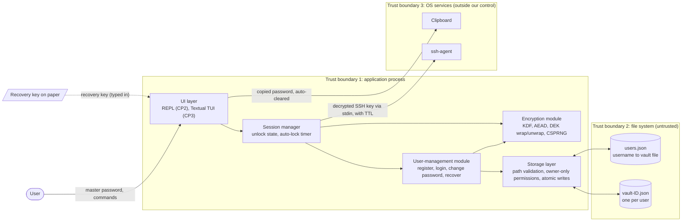

# Design Document: Password Manager

ICS0022 Secure Programming, semester project. Written for Checkpoint 1 (threat model and
architecture) and kept up to date while the code is built: §6 records where the build differs from
the original design, and §7 maps every threat to the code and tests that handle it.

## 1. Assets

Threat-modelling step 1: identify what the system must protect.
C = confidentiality, I = integrity, A = availability.

| # | Asset | Where it lives | Protect |
|---|---|---|---|
| A1 | **Stored credentials**: site usernames, passwords, URLs, notes | Encrypted in the user's vault file; plaintext in RAM while unlocked | C, I, A |
| A2 | **Master password** | User's memory, then keyboard/terminal input, then RAM until the key is derived | C |
| A3 | **Keys**: the key-encryption key (KEK) derived from the master password, and the random data key (DEK) that encrypts the vault | RAM only, while unlocked; the DEK is stored on disk only in wrapped (encrypted) form | C |
| A4 | **Vault file**: ciphertext, wrapped DEKs, KDF salt and parameters, nonce, authentication tag | Disk, one file per user | I, A |
| A5 | **User account records**: username to vault-file mapping | Disk | I |
| A6 | **TOTP secrets**: 2FA seeds for the user's other accounts | Inside the vault; RAM while unlocked | C |
| A7 | **SSH private keys** | Inside the vault; RAM; the OS ssh-agent until the TTL expires | C |
| A8 | **Transient output**: clipboard contents, terminal screen and scrollback | OS clipboard, terminal | C |
| A9 | **Recovery key**: shown once at registration, kept by the user on paper | Paper (outside the system); RAM while it is being used | C |

Notes:

- A1 and A4 are the same data in two states. The file's confidentiality comes from encryption, but the
  file itself must also be protected against tampering, rollback to an older copy, and loss.
- The KEK and the DEK (A3) are more valuable than the master password: anyone holding them does not need
  the password at all, and they stay in memory for the whole unlocked session.
- TOTP secrets (A6) are stored next to the passwords, so one breach of the vault defeats both factors.
  This is a deliberate usability trade-off.
- The recovery key (A9) is a second way into the vault, as powerful as the master password. It exists
  for availability: without it, a forgotten master password means the vault is permanently lost.

## 2. Architecture

Threat-modelling steps 2 and 3: architecture overview and decomposition.

The UI is a thin layer on top of a UI-independent core, so the prompt REPL (CP2) can be replaced by a
Textual TUI (CP3) without touching any security code. The UI never handles keys or files directly.



### Components

| Component | Responsibility | Holds secrets? |
|---|---|---|
| UI layer | Reads input, shows results. Masks password input and never echoes secrets. | Master password briefly, while it is passed on |
| Session manager | Keeps the unlocked state; locks and discards keys after inactivity or on `lock`/`quit` | DEK while unlocked |
| User-management module | Registration, login, master-password change, recovery-key unlock; one vault per user | Master password and KEK, briefly |
| Encryption module | Derives keys from passwords, encrypts and decrypts the vault (authenticated), wraps and unwraps the DEK, generates passwords and keys with a CSPRNG | Keys only for the duration of a call |
| Storage layer | The only component that touches the disk: validates paths, creates files with owner-only permissions, writes atomically (temp file, then rename) | Never plaintext, only ciphertext |

### Where files and keys live

| Item | Location | Form |
|---|---|---|
| Data directory | `~/.yunarpass/` by default, overridable with the `YUNARPASS_HOME` environment variable (never with a command-line path) | Created owner-only |
| Vault contents (A1, A6, A7) | `vault-<id>.json` in the data directory | Encrypted and authenticated with the DEK |
| DEK | Vault file header | Wrapped twice: by the KEK from the master password, and by the key from the recovery key |
| KEK | RAM only | Derived at login, discarded after the DEK is unwrapped |
| DEK in plaintext | RAM only | Only while unlocked; dropped on lock, auto-lock or exit |
| Master password / recovery key | Never stored | Typed in, used to derive a key, then dropped |
| Account records (A5) | `users.json` | No secrets; its integrity is checked because each vault is bound to its username |

### Trust boundaries

1. **User and terminal to process.** All input is untrusted and validated against an allow-list
   (entry names, lengths, commands).
2. **Process to file system.** The disk is untrusted: another OS user, malware or a backup tool may
   read, copy, replace or roll back files. Everything written there is therefore encrypted and
   authenticated, and file paths are never built from raw user input.
3. **Process to OS services.** Data given to the clipboard or the ssh-agent leaves our control. We
   limit its lifetime (clipboard clearing, agent TTL) but cannot enforce it.
4. **User to user.** Accounts are separated cryptographically: each user has their own vault and their
   own keys. One user's password can never decrypt another user's vault.

### Data flow: unlock

1. The user enters their username and master password (input masked).
2. The storage layer finds the user's vault file through `users.json` and reads its header.
3. The encryption module derives the KEK from the password and the salt in the header, then unwraps the DEK.
   If the authentication tag fails, the login fails with a generic error; there is no separate password check that could leak information.
4. The DEK decrypts the vault into RAM. The password and the KEK are dropped.
5. The session manager keeps the DEK until lock, auto-lock or exit. Every save re-encrypts the vault with a fresh nonce and writes it atomically.

## 3. Threat model

Threat-modelling steps 4 to 6: identify, document and rate the threats. Threats are written as
**misuse cases** (Alexander, *Misuse Cases*, 2003): a misuse case **threatens** a use case, and a use
case (a security function of the tool) **mitigates** a misuse case.

### Use cases

| ID | Use case |
|---|---|
| UC1 | Register an account (creates the vault and shows the recovery key once) |
| UC2 | Unlock the vault (log in) |
| UC3 | Add, view, edit or delete an entry |
| UC4 | Copy a password to the clipboard |
| UC5 | Generate a password |
| UC6 | Lock / auto-lock |
| UC7 | Change the master password |
| UC8 | Recover access with the recovery key |
| UC9 | Show a TOTP code |
| UC10 | Load an SSH key into the ssh-agent |

### Misusers

| ID | Misuser | Capability |
|---|---|---|
| M1 | **Thief** | Has a copy of the files: stolen laptop or disk, backup, cloud sync. Unlimited offline time. |
| M2 | **Local user** | Another person or OS account on the same machine, or another account of this tool. |
| M3 | **Malware** | Code running as the same OS user while the tool is in use. |
| M4 | **Onlooker** | Can see the screen or the paper recovery key. |

Rating: likelihood (L/M/H) times impact (L/M/H) gives a risk of Low, Medium or High.

### Example misuse-case diagram (master password area)


### Master password (A2, A9)

| ID | Misuse case (misuser) | Threatens | Risk | Mitigation | Residual risk |
|---|---|---|---|---|---|
| T1 | Brute-force the master password offline against a copied vault file (M1) | UC2 | High | Memory-hard KDF (Argon2id) with a per-user random salt; at least 12 characters and not in a blocklist of the 10 000 most common passwords, checked at UC1/UC7 | A weak but allowed password can still be guessed eventually |
| T2 | Guess passwords online at the login prompt (M2) | UC2 | Medium | The KDF makes every attempt slow; a delay of 1 s after the first failure, doubling after each further one. The delay values are constants in the code; configuration can only make them stricter | The offline attack (T1) skips our program entirely, so only the KDF cost applies there |
| T3 | Read the password as it is typed (M4) | UC2 | Low | Masked input, never echoed | Physical observation of the keyboard |
| T4 | Learn which usernames exist from error messages or timing (M2) | UC2 | Low | One generic login error; the KDF also runs for unknown usernames | None significant |
| T5 | Steal or photograph the paper recovery key (M4) | UC8 | Medium | High-entropy key shown only once; using it forces a new master password and a new recovery key | Unlike 1Password's Emergency Kit, which is a second factor, our recovery key alone opens the vault. This is a deliberate trade of confidentiality for availability |

### Vault at rest (A1, A4, A5, A6, A7)

| ID | Misuse case (misuser) | Threatens | Risk | Mitigation | Residual risk |
|---|---|---|---|---|---|
| T6 | Read the vault file from the disk or a backup (M1) | UC3 | High | The whole vault is encrypted with authenticated encryption (AEAD); plaintext is never written to disk, not even to temp files | Depends on T1 (password strength) |
| T7 | Tamper with the vault, e.g. weaken the KDF parameters in the header (M1, M2) | UC2, UC3 | Medium | The header is authenticated as associated data; KDF parameters below a minimum hard-coded in the program are rejected when loading, and configuration can only raise them. Parameters above a hard-coded maximum are rejected too, so an edited header cannot make the program exhaust memory before the check fails | None significant |
| T8 | Swap vault files between users or edit `users.json` (M2) | UC2 | Medium | The username is bound to the vault as associated data, so a swapped vault fails to decrypt | None significant |
| T9 | Roll the vault back to an older copy (M1, M2) | UC3 | Low | A version counter inside the encrypted vault is shown to the user after unlock | Not fully preventable locally: the attacker can roll back every file at once. Accepted |
| T10 | Crash or power loss during a save corrupts the vault (availability) | UC3 | Medium | Atomic save: write a temp file, flush it, then rename; the previous encrypted copy is kept as a backup | Disk failure; users are told to back up the vault file |
| T11 | Path traversal or a symlink/hard link through a crafted username or file name (M2) | UC1, UC2 | Medium | Vault file names are random IDs, never the username; usernames are checked against an allow-list; the tool refuses symlinks and files it does not own; the data directory is owner-only | None significant |
| T12 | Another OS user reads the vault files (M2) | UC3 | Low | Files created owner-only, as defence in depth on top of T6: mode 0600 (directory 0700) on POSIX; on Windows a protected ACL that grants access to the current user only, set when the file is created, so there is no moment when the file is readable by others (§6) | An administrator can always read them, but only as ciphertext |

### Vault in memory (A1, A2, A3)

| ID | Misuse case (misuser) | Threatens | Risk | Mitigation | Residual risk |
|---|---|---|---|---|---|
| T13 | Read secrets from the process memory (M3) | UC2, UC3 | Medium | Secrets are kept alive as briefly as possible: the password and KEK are dropped right after the DEK is unwrapped, and the DEK is dropped on lock. The KEK and the DEK are written by the library straight into `bytearray` buffers (`derive_into`, `decrypt_into`), which are zeroed when no longer needed, so these keys never exist as immutable `bytes` in Python. Wiping is best-effort only | Python `str` is immutable, so the master password itself cannot be overwritten, and the library may keep internal copies of keys. Wiping cannot be guaranteed; only the lifetime is controlled. Malware running as the user is ultimately out of scope (see Assumptions) |
| T14 | Secrets written to disk through the pagefile, swap or a crash dump (M1) | UC2 | Low | Core dumps disabled where the OS allows it; secrets kept in memory only briefly | The Windows pagefile cannot be controlled from Python. Accepted |
| T15 | Use an unlocked session left unattended (M2, M4) | UC3 | Medium | Auto-lock after 5 minutes of inactivity; `lock` command; keys discarded on lock | Within the timeout window |

### Interface (A2, A8)

| ID | Misuse case (misuser) | Threatens | Risk | Mitigation | Residual risk |
|---|---|---|---|---|---|
| T16 | Secrets leak into the shell history or process list (M2, M3) | UC2, UC3 | Medium | Secrets are never accepted as command-line arguments, only through masked prompts | None significant |
| T17 | Secrets leak through logs, error messages or tracebacks (M2) | all | Medium | No secrets are logged; the user sees generic errors, never raw tracebacks | None significant |
| T18 | Read a copied password from the clipboard or clipboard history (M3) | UC4 | Medium | Clipboard cleared after 20 seconds, but only if it still holds our value, so a newer copy by the user is never overwritten; also cleared on lock and quit. On Windows the copy is marked with the `ExcludeClipboardContentFromMonitorProcessing`, `CanIncludeInClipboardHistory` = 0 and `CanUploadToCloudClipboard` = 0 formats, which keep it out of the Win+V history and the cloud clipboard | Any process of the same user can read the clipboard within the 20 s, and third-party clipboard managers may ignore the exclusion formats. Accepted and documented |
| T19 | Malicious input: overlong fields, control characters, terminal escape sequences in entry names (M2) | UC3 | Low | Allow-list validation and length limits at input; control characters removed on output | None significant |
| T20 | Guess generated passwords because they are predictable | UC5 | High if present | Generated with the `secrets` CSPRNG, never `random` | None significant |
| T25 | Read a stored or generated password from the screen, the terminal scrollback or a screen recording (M4, M3). *Added in CP2, see §6* | UC3, UC5 | Medium | Passwords are never printed: `show` always masks, `gen` copies the password or fills it into the entry, and `copy` is the only way to use a stored password | The recovery key is printed once at registration and recovery, because the user must write it down; it stays in the scrollback until the terminal is closed or cleared (see T5) |

### Extra features and supply chain

| ID | Misuse case (misuser) | Threatens | Risk | Mitigation | Residual risk |
|---|---|---|---|---|---|
| T21 | One vault breach reveals both a password and its TOTP secret (M1, M3) | UC9 | Medium | Same protection as the rest of the vault | Storing both factors together is a deliberate usability trade-off. Accepted and documented |
| T22 | Another process uses or reads an SSH key loaded into the agent (M3) | UC10 | Medium | The key goes to `ssh-add` through stdin, never as a file; loaded with a 10-minute lifetime (`-t 600`) | Any process of the same user can use the agent until the lifetime ends |
| T23 | A malicious or vulnerable dependency (supply chain) | all | Medium | Few, well-known libraries; pinned versions; dependency scanning in CI | Trust in the chosen libraries |
| T24 | Modify the installed program or its dependencies to capture the master password (M2, M3) | UC2 | Medium | Installed where normal users cannot write; dependencies pinned with hashes (`pip --require-hashes`); release checksums published for verification | Anyone who can write to the install can change anything. A self-check inside the program could simply be removed, so none is claimed. The vault does not depend on the program: without the password, a modified copy cannot decrypt anything |

### Assumptions and out of scope

- The operating system and the Python interpreter are not compromised. Malware with administrator
  rights, keyloggers and kernel-level attacks can defeat any local password manager.
- Hardware attacks such as cold-boot memory attacks are out of scope.
- The user chooses a master password that meets the policy, and keeps the recovery key private.

## 4. Cryptographic scheme and vault format

Initial design decision. Every choice below traces back to a threat in section 3.

### Scheme: envelope encryption

```
master password --Argon2id(salt)-------> KEK_pw --AES-256-GCM wrap--+
                                                                    +--> DEK (random 256-bit) --AES-256-GCM--> vault body
recovery key   --HKDF-SHA256(salt)----> KEK_rk --AES-256-GCM wrap--+
```

| Element | Choice | Why (threat) |
|---|---|---|
| Password KDF | **Argon2id**, 64 MiB memory, 3 iterations, 4 lanes, 16-byte random salt, 32-byte output (RFC 9106 recommended profile). The password is Unicode-normalized (NFC) and UTF-8 encoded first | Slow and memory-hard, so offline guessing on GPUs is expensive (T1). The salt defeats precomputed tables. NFC makes the same password typed with composed or decomposed accents give the same key |
| Parameter floor and ceiling | The minimums above are constants in the code; a vault header with weaker parameters is refused. A maximum (1 GiB, 64 iterations, 16 lanes) is enforced the same way | T7: an attacker cannot make brute force cheaper by editing the header or a config file, nor make the program allocate unbounded memory before the tag check can fail |
| Data key (DEK) | 256 random bits from the OS CSPRNG (`secrets`) | Independent of the password, so changing the password only re-wraps the DEK (UC7) |
| Encryption | **AES-256-GCM** (authenticated encryption, AEAD) for the vault body and for each wrapped DEK | Confidentiality (T6) and integrity: any modified byte makes decryption fail (T7, T8) |
| Nonces | A fresh random 96-bit nonce for every encryption, including every save | A nonce must never repeat under the same key. With random nonces, the safe limit (about 2^32 encryptions per key) is far beyond our save volume |
| Associated data | The header (format version, vault ID, username, KDF parameters and salts) is passed as associated data to all three encryptions: both DEK wraps and the body. It is authenticated but not encrypted | Binds each vault to its owner and its parameters; any change to the header makes every unwrap and the body decryption fail (T7, T8) |
| Password change (UC7) | A new salt and KEK are derived from the new password and the DEK is re-wrapped; the body and the recovery wrap are unchanged | The vault is never re-encrypted, so a change is fast and cannot half-complete |
| Recovery key | 160 random bits, shown once as 32 Base32 characters in groups of 4; its KEK is derived with **HKDF-SHA256** | It is already high-entropy, so a slow KDF is not needed. Using it forces a new master password and a new recovery key (T5) |
| Login check | No password hash is stored. A wrong password fails the tag check when unwrapping the DEK | No extra offline target on disk; one generic error (T4) |
| Password generator | `secrets` module, 20 characters by default | CSPRNG output, not predictable (T20) |
| TOTP codes | `cryptography`'s TOTP implementation (RFC 6238) | No extra dependency (T23) |

### Vault file format (`vault-<id>.json`, format version 1)

A UTF-8 JSON document. Binary fields are Base64-encoded. It is parsed strictly: unknown fields,
missing fields, wrong types and oversized values are rejected before any cryptography runs.

```json
{
  "format": 1,
  "vault_id": "3f9c0d2e8a7b4c61a2e5f0b9d8c7a6e1",
  "username": "alice",
  "kdf": { "alg": "argon2id", "m_kib": 65536, "t": 3, "p": 4, "salt": "<b64, 16 bytes>" },
  "wrapped_dek": {
    "password": { "nonce": "<b64, 12 bytes>", "ct": "<b64, 32-byte DEK + 16-byte tag>" },
    "recovery": { "salt": "<b64, 16 bytes>", "nonce": "<b64, 12 bytes>", "ct": "<b64>" }
  },
  "body": { "nonce": "<b64, 12 bytes>", "ct": "<b64, encrypted entries + tag>" }
}
```

The decrypted body is also JSON:

```json
{
  "counter": 42,
  "entries": [
    { "id": "...", "type": "login", "name": "github", "username": "...", "password": "...",
      "url": "...", "notes": "...", "created": "...", "modified": "..." },
    { "id": "...", "type": "totp", "name": "google", "secret": "..." },
    { "id": "...", "type": "ssh", "name": "work-server", "private_key": "..." }
  ]
}
```

`counter` increases on every save and is shown after unlock, which helps the user notice a rollback (T9).

`users.json` holds only `username` → `vault_id` and contains no secrets. Vault file names are
random IDs, never usernames (T11). Registration refuses an existing username, and `users.json` is
written atomically in the same way as the vault, so two registrations cannot corrupt it.

### Limits (constants in the code; configuration may only tighten them)

| Limit | Default |
|---|---|
| Master password | at least 12 characters, not in the 10 000-most-common blocklist |
| Argon2id floor | 64 MiB, 3 iterations, 4 lanes |
| Argon2id ceiling | 1 GiB, 64 iterations, 16 lanes |
| Login delay | 1 s after the first failure, doubling |
| Auto-lock | 5 minutes idle |
| Clipboard clear | 20 seconds |
| ssh-agent key lifetime | 10 minutes |

## 5. Language and libraries

**Python 3.12+.** I have much more experience with Python than with C, and unfamiliar code is where
implementation errors come from, so choosing the language I know reduces the chance of
introducing vulnerabilities. Python is also memory-safe: bounds checking, automatic memory management
and arbitrary-precision integers remove whole classes of C vulnerabilities, such as buffer overflows,
use-after-free, integer overflow leading to undersized buffers, and format-string attacks.
The cost is that Python cannot reliably wipe secrets from memory, because `str` and `bytes` are
immutable and may be copied. This is handled as partial mitigation plus accepted residual risk
(T13, T14).

| Library | Purpose | Why |
|---|---|---|
| `cryptography` (pyca, >= 47) | Argon2id, AES-256-GCM, HKDF, TOTP | Widely used and audited; one dependency covers every primitive, so we do not implement any cryptography ourselves. Version 47 is the first that can derive and decrypt keys into a caller's buffer (D9) |
| `pywin32` (Windows only) | Owner-only ACL when creating the data directory and files (T12); clipboard copy that stays out of the clipboard history (T18) | `os.chmod` on Windows can only set the read-only flag, so the standard library cannot make a file owner-only. A plain-text clipboard library cannot set the history-exclusion formats. Replaces `pyperclip` (§6) |
| `pbcopy` / `wl-copy` / `xclip` (system tools, macOS and Linux) | Clipboard copy and clearing outside Windows | Already on the system, so no Python dependency; called by absolute path with an argument list, never through a shell |
| `textual` (CP3) | Full-screen TUI | Modern terminal UI on top of the same core |
| Standard library: `secrets`, `getpass`, `json`, `os`, `pathlib` | CSPRNG, masked input, parsing, file I/O | No extra dependencies |

Development and CI: `pytest` with `pytest-cov` (branch coverage, at least 80%), `ruff`, `mypy`,
`bandit` (static security analysis), `pip-audit` (known vulnerabilities in dependencies) and
`gitleaks` (secrets committed by mistake, searched in every commit, not just the latest). Type
checks and tests run on Ubuntu and Windows with Python 3.12 and 3.14, because file permissions,
links and the clipboard behave differently on each OS. All dependency versions are pinned with
hashes, and the CI actions are pinned by commit (T23, T24).

## 6. As built

Where the build differs from the design above, and why. The sections above are already updated to
match; this log keeps the history of each change.

| # | Date | Design said | As built | Why | Threats |
|---|---|---|---|---|---|
| D1 | 10 Oct 2026 | `copy` in Checkpoint 3 | `copy` in Checkpoint 2 | The CP2 brief requires an interface that never prints passwords. Without printing, the clipboard is the only way to use a stored password | T18, T25 |
| D2 | 10 Oct 2026 | `show --reveal` prints the password | `--reveal` removed; `show` always masks | A printed password is on the screen and in the scrollback, which the brief forbids | T25 |
| D3 | 10 Oct 2026 | `gen` prints the generated password | `gen` copies it to the clipboard. In `add` and `edit`, typing `gen` at the password prompt fills the entry instead | Same rule as D2 | T20, T25 |
| D4 | 10 Oct 2026 | Clipboard through `pyperclip` | `pywin32` (`win32clipboard`) on Windows; `pbcopy`, `wl-copy` or `xclip` on macOS and Linux | `pyperclip` sets plain text only. Through `pywin32` the copy also carries the formats that keep it out of the Win+V history and the cloud clipboard. Outside Windows the system tools need no Python dependency | T18, T23 |
| D5 | 10 Oct 2026 | "owner-only ACL on Windows", mechanism not chosen | `pywin32` creates the data directory and every file with a protected ACL that grants access to the current user only. At startup the ACL is read back and checked | `os.chmod` cannot restrict reading on Windows. Setting the ACL at creation leaves no moment when a file is readable by others, and the startup check catches a directory that someone else created or changed | T11, T12 |
| D6 | 10 Oct 2026 | No platform named | Windows 10/11 is the primary platform (development and the demo); Linux is supported and tested in CI | Permissions and the clipboard work differently on each OS, so both code paths are built and tested | T12, T18 |
| D7 | 10 Oct 2026 | — | New threat T25: a password read from the screen or the scrollback | It is the threat behind the "never prints passwords" rule and had no row of its own | T25 |
| D8 | 10 Oct 2026 | Only a minimum for the Argon2id parameters | A maximum as well: 1 GiB, 64 iterations, 16 lanes | Without it, an edited header could ask for terabytes of memory or hours of hashing, and the program would try before the authentication tag can fail (availability) | T7 |
| D9 | 10 Oct 2026 | "Only the lifetime is controlled" for keys in memory | The KEK and the DEK are written straight into `bytearray` buffers that are zeroed after use; a failed unwrap zeroes its buffer at once | `cryptography` ≥ 47 can derive and decrypt into a caller's buffer, so these two keys never exist as immutable `bytes` in Python. The master password (a `str`) still cannot be wiped | T13 |

### Brief requirements met in a different way

| The project brief says (Projects.pdf §4.2) | How this project meets it |
|---|---|
| The master password is "stored securely with a hashing method such as bcrypt, never in plaintext" | Nothing derived from the master password is stored, not even a hash. Argon2id, a password-hashing function like bcrypt, derives the KEK, and a login succeeds only if that KEK unwraps the DEK, which AES-GCM authenticates (§4, *Login check*). Argon2id won the Password Hashing Competition and is OWASP's first choice: it is memory-hard, whereas bcrypt uses about 4 KiB of memory and is therefore cheaper to attack on GPUs. A stored bcrypt hash next to the vault would also give an attacker a second, weaker target than the Argon2id-protected key (T1) |
| "Sensitive data such as passwords must be wiped from memory immediately after use" | Best effort only, because Python strings and bytes cannot be overwritten (T13). The session keeps the DEK in a `bytearray` that is zeroed on lock (#28), and every secret is kept alive as briefly as possible. The rest of the secure-memory work is Checkpoint 3 |

## 7. Threat → code → test map

Every threat from §3 with the issue that builds its mitigation, and the code and tests that implement
and prove it. The pull request that implements a mitigation fills in its code and test cells;
"—" means not built yet. Issue numbers refer to the GitHub issues of this repository.

| Threat | Mitigation in short | Issue | Code | Tests |
|---|---|---|---|---|
| T1 offline brute force | Argon2id with a parameter floor; master-password policy | #16, #22, #26 | `crypto.py`: `KdfParams`, `derive_kek` | `test_crypto.py`: `test_argon2id_matches_rfc9106_vector`, `test_derive_kek_known_answer`, `test_kdf_params_new_uses_the_floor_and_a_fresh_salt` |
| T2 online guessing | KDF cost per attempt; delay doubling after each failure | #23 | — | — |
| T3 password seen while typed | Masked input | #21 | — | — |
| T4 username enumeration | One generic error; the KDF also runs for unknown usernames | #23 | — | — |
| T5 recovery key stolen | 160-bit key shown once; using it forces a new password and key | #17, #22, #27 | — | — |
| T6 vault read from disk | AES-256-GCM over the whole body; no plaintext on disk | #16, #20 | `crypto.py`: `encrypt`, `decrypt` | `test_crypto.py`: `test_encrypt_decrypt_round_trip`, `test_decrypt_with_wrong_key_fails`, `test_nonces_are_unique` |
| T7 header tampering | Header authenticated as AAD; KDF floor and ceiling enforced on load | #16, #20 | `crypto.py`: `KdfParams.check`, AAD in `encrypt`/`decrypt`/`unwrap_dek` | `test_crypto.py`: `test_kdf_params_outside_limits_are_refused`, `test_derive_kek_rechecks_params`, `test_changed_associated_data_fails`, `test_flipped_ciphertext_bit_fails` |
| T8 vaults swapped between users | Username bound into the AAD | #16, #20, #23 | `crypto.py`: AAD is required and non-empty | `test_crypto.py`: `test_changed_associated_data_fails` (other username), `test_empty_associated_data_is_refused` |
| T9 rollback | Counter inside the encrypted body, shown after unlock | #20, #23 | — | — |
| T10 crash during save | Atomic write with a backup copy | #19 | — | — |
| T11 path traversal, symlinks, hard links | Random file names, allow-lists, links and foreign-owned files refused | #18, #19, #22 | — | — |
| T12 other OS users read files | Owner-only permissions set at creation | #18 | — | — |
| T13 secrets read from memory | Short key lifetime; keys in wipeable buffers; DEK zeroed on lock (best effort) | #16, #28; CP3 | `crypto.py`: `derive_kek`/`unwrap_dek` return `bytearray`, `wipe` | `test_crypto.py`: `test_wipe_zeroes_the_buffer_in_place`, `test_wrap_unwrap_round_trip` |
| T14 secrets in swap or crash dumps | Core dumps disabled where the OS allows | CP3 | — | — |
| T15 unattended session | `lock` and 5-minute auto-lock | #28 | — | — |
| T16 secrets in shell history | Secrets only through masked prompts, never as arguments | #21 | — | — |
| T17 secrets in errors or logs | Generic errors, no tracebacks; logging in CP3 | #21; CP3 | — | — |
| T18 clipboard | 20 s clear; Windows history exclusion; cleared on lock | #25, #28 | — | — |
| T19 malicious input | Allow-lists, length limits, output sanitizer | #21, #24 | — | — |
| T20 predictable generated passwords | `secrets` CSPRNG | #17, #25 | — | — |
| T21 password and TOTP secret together | Same protection as the vault; accepted trade-off | CP3 | — | — |
| T22 SSH key misused from the agent | Key passed via stdin; 10-minute lifetime | CP3 | — | — |
| T23 malicious dependency | Few libraries, pinned; `pip-audit` and secret scanning in CI; CI actions pinned by commit SHA | #10, #13, #14, #15 | `requirements.in` → `requirements.txt` (exact versions); `.github/workflows/ci.yml` (`pip-audit` step, `secrets` job, SHA-pinned actions) | A planted fake secret failed the `secrets` job and `ci-ok` (throwaway PR #32, 10 Oct 2026) |
| T24 tampered install | Dependencies installed with `--require-hashes`; the package itself with `--no-deps --no-build-isolation`, so nothing unchecked is downloaded | #15 | `requirements.txt` (SHA-256 of every published file); README *Build and run* | `readme-smoke` CI job runs the README steps on fresh Windows and Linux runners; a changed hash in `requirements.txt` makes the install stop (checked locally, 10 Oct 2026) |
| T25 password read from the screen | Passwords never printed: `show` masks, `gen` and `copy` use the clipboard | #21, #24, #25 | — | — |
